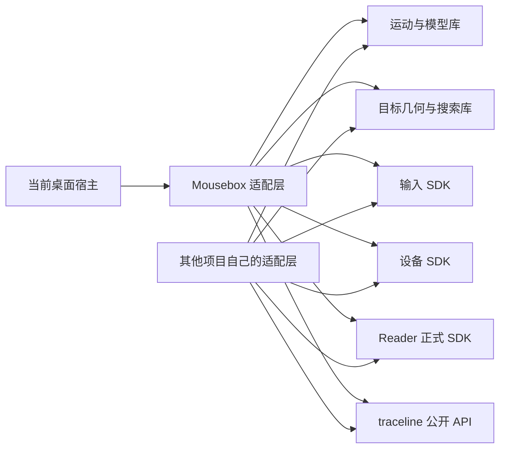

# 跨项目复用与独立仓库边界审计

审计日期：2026-11-13，北京时间。源码基线：`G:\mousebox-aimbot`，PC2.8.40。

本次以“离开 Mousebox 后，另一套程序能否只使用公开接口和必要产物完成调用”为标准。当前项目已有可复用的计算内核；主要障碍集中在运行时所有权、公开数据类型、资源获取和交付方式。直接按 Aim、ESP、Reader 页面分仓库，会继续携带 Mousebox 的设置、状态与生命周期，不能达到这个目标。

建议先建立四个独立能力仓库：鼠标运动与模型、目标几何与伤害搜索、鼠标输入与统计、Mousebox 设备 SDK。Reader 的正式 SDK 和 traceline 的公开 DLL 沿用上游。窗口与绘制库后置，先解除已确认的字体和 ESP 语义绑定。Mousebox 最终只保存这些能力的应用适配、界面和统一运行协调。

## 审计范围与验证标准

扫描了 811 个纳入范围的自有源码文件，共 52,120 行，包括原生应用、公共计算层、游戏实现、Electron、React、shared 契约及当前固件正式分层。第三方实现、历史发布、依赖目录和测试目录不计入这个数字；公开第三方头文件按独立调用需要单独检查。文件与直接依赖清单保存在 `out/reuse-audit-20261113/source-inventory.json`。

依赖清单解析 C++ include 及 TypeScript import/export，只用于定位。它不能发现所有资源、行为和 ABI 依赖。实际资源获取、状态所有权、输入输出语义和入口装配另行检查；字体的反例验证正是静态 include 检查无法证明的依赖。

复用成熟度分为：

| 状态 | 含义 |
| --- | --- |
| 已有独立接口 | 已有上游公开 SDK 或 DLL，可以直接作为依赖消费 |
| 已验证内核可提取 | 原实现原字节复制到最小包，在独立程序中编译并运行成功；仍需形成正式 SDK |
| 需重新划接口 | 存在宿主行为、产品数据或资源所有权绑定，不能整目录作为公共库 |
| 应保留为应用适配 | 页面、设置、产品权限与输出协调，负责把公共能力接入本产品 |

“命名空间叫 application”不自动代表不能复用，“没有 import application”也不自动代表已经可复用。独立调用验证和实际行为优先于目录名称。

## 独立调用验证

为每个 C++ 消费者创建了独立 `.vcxproj`，只复制实现及必要头文件，复制件与原文件逐字节一致。没有导入现有 `.sln`、`common.props`，也没有链接 `mousebox-core.lib`。验证环境为 Windows x64、MSVC v143、C++20。Node 消费者只编译了无框架依赖的 TypeScript 文件。

随后将全部 12 个消费者复制到仓库外的临时目录，使用相对工程路径并从各自目录构建、执行；DLL 也作为独立依赖复制到该目录。11 个正向调用与 1 个预期字体阻塞均再次得到相同结果，工程不指向原仓库。目录与日志索引保存在 `external-consumers.json`，排除了借用原 include 路径和工作目录的情况。

| 验证对象 | 最小复制闭包 | 实际结果 | 证明范围 |
| --- | ---: | --- | --- |
| 运动策略与模型拟合 | 17 文件 | 正向通过 | Smooth/Direct 的离线闭环与步长约束、三场合成采样拟合；无 Reader、设备、UI |
| 采样年龄与链路统计 | 5 文件 | 正向通过 | 显式时钟映射输入、年龄与不确定度、分段均值及到期清理 |
| SI 参考弹道 | 4 文件 | 正向通过 | 静止和运动目标的参考模型求解；不是游戏弹道实测 |
| 姿态命中体求交 | 6 文件 | 正向通过 | 调用方自供胶囊与骨骼姿态、相交/内缩/未命中；无需 Reader Snapshot |
| 原始报文统计 | 4 文件 | 正向通过 | 自供记录计算频率、幅度和同时间戳统计；未启动采集 |
| Raw Input 缓冲解析 | 2 文件 | 正向通过 | 自供 Windows x64 RAWINPUT 缓冲及截断拒绝；未注册输入设备 |
| Reader 原生后坐求值头 | 1 文件 | 正向通过 | 使用上游公开头文件独立求值；无需再复制一套计算内核 |
| traceline DLL | 2 个公开头文件 | 正向通过 | 动态装载真实 DLL，创建合成三角形，验证遮挡/通畅查询；没有读取地图 |
| 设备通信实现 | 17 文件 | 正向通过 | 完整串口实现能够独立编译，线协议编解码与 CRC 拒绝通过；未实例化串口连接 |
| 最高伤害搜索 | 12 文件 | 正向通过 | 自供几何和另一套伤害查询实现，搜索得到结果且遵守查询预算；无 Reader、traceline、GPU |
| JSON 树遍历与搜索 | 1 个 TS 文件 | 正向通过 | 独立 Node 程序验证字段展开、路径转义、搜索、64 位值字符串保留；无 React/Zustand/Electron |
| 绘制字体加载器 | 4 文件 | 确认阻塞 | 普通程序没有 Mousebox 内嵌字体资源，构造加载器明确失败；没有打开窗口 |

合计 11 个正向独立调用通过，另有 1 个预期反例确认资源绑定。反例的“检查通过”表示成功观察到阻塞，不能计作渲染库已经可用。

完整记录：`out/reuse-audit-20261113/probe-results.json`、`audit-verification.json`，每个消费者另有构建、执行日志与源码。运动验证不包含 Ruckig 的 `TrajectorySmooth` 独立运行；真实采集、串口执行、完整 GPU 绘制和实战效果也不属于这些结果。

## 主要复用阻塞

### 通用运行时仍借用 PUBG 的 Backend

`application::Backend` 实际定义在 [PUBG runtime](../src/games/pubg/runtime/backend.hpp#L16)，公开接口同时管理 Reader、设备输出、校准、武器部位、重力和学习模型；其 [运行模型](../src/games/pubg/runtime/runtime_models.hpp#L2)直接导入 PUBG Frame 和控制器。

[RuntimeOptions.createGameModule](../apps/native-host/bridge/runtime_service.hpp#L18)要求传入这个 Backend，CS2 的 [装配入口](../apps/native-host/composition/game_modules.cpp#L37)也通过它取得设备输出。这说明目前的“通用宿主”仍以 PUBG 的应用对象为基础。把 CS2 或 Aim 目录搬走，外部程序仍会被迫取得这套 Backend。

迁移时应把设备连接与唯一写入者、会话撤销、源连接和各游戏控制状态分别明确归属。独立能力库不得接受 Backend、RuntimeService 或全局工作区作为入口；Mousebox 的应用适配层负责把它们连接起来。这是迁移整套游戏运行模块前的阻塞，不妨碍先发布已独立的数值内核。

### 绘制层没有游戏 include，但公开类型仍含 ESP 产品语义

[Primitives](../src/render/primitives.hpp#L83)含队伍/锁定颜色分组、名字、血量、距离、观战人数、瞄准范围和目标锁定。[SceneSubmission](../src/render/scene_submission.hpp#L23)还直接携带 Reader 的 SourceSample、SourceReceipt。它是本产品的 ESP 绘制边界，尚非一般绘图库的公共协议。

另一处行为绑定来自 [字体加载器](../src/render/bundled_font.cpp#L30)：`GetModuleHandleW(nullptr)`从调用方 EXE 查找指定资源 ID。即使把这个实现编译进新 DLL，只要调用方 EXE 没有该资源，问题仍然存在。独立反例实际返回 `Bundled primary font resource is missing`。

可提取的底层应接受线、圆、路径、文本、网格、图层及调用方提供的字体资源，完成回调仅携带调用方关联标识。ESP 的分组、标注布局和 Reader 计时配对留在适配层。字体内容、家族和生命周期应显式传入，不能要求其他项目复制本产品 EXE 资源约定。

[叠加窗口](../apps/native-host/window/overlay_surface.hpp#L8)同时拥有当前 Renderer、GameWindowTarget 和应用 JSON 状态，不能单独搬走就当成通用叠加层。底层窗口跟踪应接受明确的 HWND/PID/客户区策略；游戏身份与前台政策由调用方适配。

### Raw Input 的底层解析可用，完整采集器混合了两种产品流程

[RawCapture](../apps/native-host/input/raw_capture.hpp#L16)同时拥有消息窗口、父进程/前台判定、活动矩形、光标限制恢复、设备选择、学习分段、原始报文记录和回调。它区分学习与报文模式，并直接使用应用层记录类型。

当前采集服务由 [Node 原生插件](../apps/native-host/input/addon/entry.cpp#L35)在其进程内创建；C++ native 宿主通过管道取得结果。原始报文处理没有逐包进入 JS。不能把现状误描述为另一个独立采集进程，也不能为插件化把报文改走 JS。

独立输入 SDK 应拥有进程内统一注册/分发及采集会话，提供设备标识、相对记录、时钟信息和丢弃计数；Node/管道只是可选绑定。DOM 区域结算、滚动、学习场次、页面切换与何时限制光标由应用适配决定。Windows 的注册所有权由同一个协调者管理，不能让每个消费插件各自覆盖注册。

两种记录语义必须分别公开：[原始报文](../apps/native-host/input/raw_capture.cpp#L539)保存逐包 dx/dy；[学习样本](../apps/native-host/input/raw_capture.cpp#L562)保存累计 x/y。把两者混用会直接改变统计与拟合结果。

### 运动内核已经独立，但当前输入和预设不是任意设备的通用协议

[movement::Input](../src/control/movement/types.hpp#L18)明确使用角差与每计数角度，并附带后坐和采样时序；它不读取游戏，独立验证也通过。因此第一批应发布这部分真实能力，而不是再次拆 UI。

需要分开的部分包括：

- [五档速度](../src/control/speed_policy.cpp#L14)、历史版本选择和实验开关，是当前应用的策略映射。
- [DeviceMotionLimits](../src/control/device_motion.hpp#L17)规定 2–30ms 间隔和当前线协议范围；将其当作所有设备的共同限制，会排除采用其他周期的消费者。
- [策略集合](../src/control/movement/controller.hpp#L12)是固定 variant，新增策略仍要重编译；目前的算法下拉框不构成独立算法插件机制。
- [模型有效性](../src/control/human_model.cpp#L12)包含三场采样、训练/验证覆盖、1600 DPI 参考和具体统计阈值。这是当前速度模型的契约，不是已经实现的完整人手轨迹模型。

初版 SDK 应准确命名其“角差到计数”的能力，公开 dt、单位、反馈、限制和实例状态。像素/绝对坐标等消费者需要自己的映射，不能仅改参数名称就宣称已支持。原五档、硬件校验与版本默认值保留在 Mousebox 适配中，不借抽取改动现有数值行为。

### 最高伤害搜索应留在消费算法侧，几何实现与帧适配可以分开

[damage_search::search](../src/games/cs2/damage_search/search.hpp#L36)只需要 Pose、起点、伤害查询接口、预算、可选种子和取消信息。独立程序用另一套查询实现成功运行，证明它不必依赖 traceline 的内部代码，更不必依赖 ESP。

相反，[BestDamageExtension](../src/games/cs2/extensions/best_damage/extension.cpp#L24)负责从 Snapshot 筛人、绑定地图和武器、分配帧预算、发布应用结果；这些是适配与调度。应将纯搜索、几何和评分与这层分开，避免把“挑最高伤害点”移进 traceline。

同样，[prepare](../src/games/cs2/hitboxes/pose.hpp#L31)可接收外部模型和骨骼变换；[fromBody](../src/games/cs2/hitboxes/frame.hpp#L7)才是 Reader/游戏帧到几何的适配。公共几何接口需要说明坐标、四元数/尺度语义以及 Definition/ModelAsset 借用内存的存活期。当前变换保留已核验的 Source 2 行为，不能在迁移中擅自归一化或更换数学公式。

### shared 契约与设置仍是封闭的应用总表

[GameId](../packages/shared/src/models/workspaces.ts#L3)是固定枚举；[SettingKey](../packages/shared/src/models/settings.ts#L8)由 PUBG/CS2 参数总表推导；[GameUiModule](../apps/ui/src/games/contracts.ts#L30)直接规定 AimSettings、Triggerbot、Rage、Recoil 等插槽。[RuntimeStore](../apps/ui/src/runtime/state.ts#L22)同时持有各功能的总状态。

这套契约适合当前应用内部通信，不能直接命名为“通用插件 SDK”交给其他项目。真正的能力库只公开自己的请求、结果、错误与版本，不要求消费者导入整份 Bootstrap、工作区或所有游戏的参数。

[配置读取](../src/application/settings/configuration_documents.cpp#L56)逐键交给已登记的游戏校验器。因此插件外移后简单删除旧注册，可能使其遗留配置变成未知键并阻止载入。插件配置要有独立归属、schema 和迁移版本；未安装插件的数据应保留为不生效状态，不能静默删除或混入别的游戏。宿主名称变化也不应顺带更换现有数据根。

### 现有 Extension 是内部接口，不能直接充当跨项目二进制标准

[Extension](../src/application/extensions/contracts.hpp#L51)基于 C++ 模板、虚函数、shared_ptr、Attachment 和应用 Scope，并携带标题、游戏与设置键。它已对内部调度解耦，但还不是任意进程/工具链可以装载的公共二进制接口。

能力库的公开接口应由能力本身拥有。需要二进制/跨语言消费时，明确版本、结构尺寸、句柄、缓冲所有权、错误、并发和销毁规则；只供相同工具链的 C++ 源码消费，也可以先提供清楚的 C++ API。无需为了“插件”把所有组件都做成常驻进程或逐帧 JSON 服务。同名 Vec3 可能拥有不同单位、轴和变换语义，各库保留最小公开类型并由适配器显式转换，不能因此合并 PUBG 与 CS2 的 Frame。

宿主插件接口只定义如何登记功能、接入状态/设置与调度，不承载所有能力的业务 DTO。各库不依赖这个宿主接口；Mousebox 的薄适配层依赖两边。

### 构建和资源交付仍绑定整套产品

[core 工程](../projects/mousebox-core.vcxproj#L17)一次收集全部 `src/**/*.cpp`，并导入固定 Reader 客户端源码。当前没有为上述能力分别提供受支持的构建入口、产物清单和消费示例。链接整个 core 或复制整份 shared 不是 SDK 接入方式。

独立程序证明可以形成更小的构建闭包，但这些审计产物不等于已经发布的 SDK。每个新仓库需要自己的公开 include、明确源列表、外部依赖、可选后端、独立构建和测试、版本化交付。宿主可消费其固定版本产物，继续保持现有正式 VS 两项目；无需把所有 SDK 的内部工程重新塞回宿主解决方案。

traceline 已经提供 [公开 C API](../third_party/traceline/include/cs2-external-autowall/api.h#L30)，应沿用其版本与资源契约。本项目的 [Provider](../src/adapters/spatial/traceline/provider.hpp#L9)是装配它到本应用的适配器，不应另开一个仓库复制上游内部算法。Reader 已提供独立后坐求值头，也应保持上游单一来源。

## 建议的仓库边界

以下是拟定边界，尚未迁移或新建远程仓库。

| 仓库候选 | 拥有的能力与状态 | 公开输入输出 | 明确留在应用适配层的内容 |
| --- | --- | --- | --- |
| `pointer-motion` | 运动积分/量化状态、拒绝回滚、可选速度模型拟合和运行模型 | 显式误差、单位映射、dt、反馈与约束 → 本步计数和状态；独立模型输入输出 | 游戏选人、Reader、后坐求值来源、五档与历史版本映射、实际串口写入 |
| `target-analysis` | 姿态几何、相交、内缩、适应性伤害搜索、可选评分 | 自供形状/姿态、射线、伤害查询、预算与种子 → 命中/最佳点/界限和原因 | 从游戏帧取人物、地图/武器来源、Reader 资格、全员帧调度、ESP 高亮和开枪执行 |
| `mouse-input` | Windows x64 注册与分发、采集会话、原始记录、统计；可选 CSV/Node 绑定 | 设备/捕获选项 → 原始记录与统计；所有时钟和记录语义明确 | DOM 矩形结算、页面状态、学习工作流、游戏前台政策、Mousebox IPC 命令名 |
| `mousebox-device-sdk` | 线协议、能力解释、串口传输、唯一有界写入队列、连接生命周期 | 显式连接与有限动作 → 能力、回传和提交结果 | Reader、目标、游戏状态、选择哪个控制器、界面、应用三秒会话政策 |

`target-analysis` 可提供 `geometry`、`damage-search`、`scoring` 分别可引用的构建目标，不要求只用几何的程序引入搜索。`pointer-motion` 的 Ruckig 后端、模型存储格式也作为可选目标，避免让基础消费者承担全部依赖。

后坐求值器、Reader 协议和地图碰撞优先沿用上游；游戏帧映射属于对应适配器。CS2 专属契约可以保留 CS2 语义，跨项目独立不意味着伪装成适用于所有游戏的数据结构。

当前“速度学习”整页和全部模型存储不宜直接作为公共模块。拟合本身可进入运动库；文件校验/格式可单独发布，启用与删除确认、跨配置引用核对和 UI 工作流仍由消费应用管理。

采样计时、滚动统计、JSON 树和页签排序已具有较好的纯函数/值对象边界。它们可以成为相应领域的可单独引用子包，不必各自建一个仓库。完整 DirectX/叠加窗口库暂缓：先定义中立图元、字体注入和完成关联标识，再取得第二个真实消费者。

固件适合保留为独立设备端项目。它已有 protocol/core/profiles/platforms/targets 和模拟目标；共享协议通过版本化发布供 PC SDK 引用，不能依赖两个仓库碰巧处于同一目录。桌面动态插件不负责加载或替代 MCU 固件。

## 独立能力与宿主适配的依赖方向

核心库不回调 Mousebox 的 RuntimeStore、工作区、页面或 Backend。其他项目可以使用任意子集，并替换查询/传输实现。独立伤害搜索消费者已经验证了替换查询实现这一点。

本机另一个实际消费者 `G:\cs2\cs2radar` 使用 Vue/Pinia/Pixi，而当前软件使用 React/Zustand。两者适合共享数据 SDK、纯分析和几何能力；整套 React 页面不能当作跨这两个项目的通用交付。JSON 遍历的独立 Node 验证表明，可以共享无 UI 内核，再分别接各自界面。

## 必须在公开 API 中写清的契约

| 事项 | 具体要求 |
| --- | --- |
| 单位 | 计数、像素、角度、米与游戏原生单位分别声明；相对报文和累计采样分别命名 |
| 时间 | 时间单位、时钟域、采样区间、映射不确定度、实例生命周期明确；估计值不冒作设备 ACK |
| 状态 | 一个调用方拥有一个实例状态；重置、拒绝、暂停和取消有明确语义，不借全局游戏设置 |
| 未知 | 缺失、错误、未命中和真实零值区分；未知伤害不能转成 0 或可穿透 |
| 内存 | 输入切片、模型定义、Pose 借用指针及结果缓冲的所有权与存活期明确 |
| 并发 | 是否可并发查询、停止与销毁的先后关系明确；不让消费者猜线程归属 |
| 资源 | DLL、地图、模型与字体由明确参数提供；不依赖宿主 EXE 资源或隐式工作目录 |
| 扩展 | 独立算法策略、可选后端与版本化资源分别管理；不把当前下拉框 ID 当通用算法标准 |
| 输出 | 控制器提交意图，消费程序统一仲裁；设备 SDK执行有限动作和协议边界，不自行解释游戏资格 |
| 交付 | 公开头/类型、产物、支持平台/工具链、依赖版本和最小消费者齐备；只发 DLL 名称不够 |

仓库分离、API 版本与资源版本分别管理。原生动态装卸必须先停止提交并撤销所有待发请求、回调和资源引用；首版采用更新后重启即可，不必同时实现运行中热卸载。插件缺失只影响依赖它的功能，不能使宿主因遗留设置无法启动。

## 迁移顺序与验收

1. **先发布运动、目标分析的最小 SDK。**保持现有算法顺序、黄金输入输出和已知模型假设，先让当前软件与独立小程序都改为消费公开包；保留原 API 适配以减少行为变化。基础库不依赖新的 Mousebox 插件 SDK。
2. **发布设备 SDK，再划输入 SDK。**设备端协议与无设备模拟先验证，物理输出仍由宿主统一授权。输入侧先拆原始记录、统计与注册所有者，再把学习和 DOM/光标策略移到应用适配。保持现有原生高频路径。
3. **重构宿主运行时及设置归属。**解除 RuntimeService 对 PUBG Backend 的要求，形成独立的设备/会话协调；把封闭 GameId、参数总表和业务插槽改成登记机制，同时迁移现有设置，保留未知插件的数据。
4. **再实现可安装的薄插件包。**包负责登记页面、设置、状态和能力适配，引用已发布 SDK。不能让独立能力库反过来依赖宿主插件接口。
5. **最后独立绘制与窗口能力。**先解除 ESP 图元、SourceSample 和指定字体资源依赖，再以普通可视化程序完成第二方验收。没有消费者需要时，可继续作为宿主内部实现，不为仓库数量重写。

每个独立仓库的交付验收至少包含：另一个目录能单独构建、只使用公开入口的示例能够运行、宿主只消费发布产物、不依赖原仓库绝对路径、必要资源由调用方指定、缺失能力有明确结果、版本与数据迁移有回退办法。涉及本产品的适配仍须通过原有控制/来源/退出回归；源码独立调用不能替代真实硬件或实战验证。

## 当前文档与实施状态

[新增游戏说明](ADDING_A_GAME.md#L3)首段仍称 CS2 尚未开放瞄准，与当前实现和 PC2.8.40 不一致。后续迁移基线应使用当前源码、正式契约和现有回归，避免按旧接入说明删掉已实现行为。

本轮新增审计文档、依赖清单及独立消费者证据，没有开始上述迁移。811 个生产源码文件摘要不变；已安装 native 与 app.asar 摘要不变，README 原字节保持。没有替换/重启软件，没有修改用户设置、Reader、traceline 或固件，没有打开串口、注册 Raw Input、操作游戏或加载真实地图。既有架构检查通过 811 源文件；它证明当前仓库内分层规则成立，不证明已经形成跨项目 SDK。

证据目录：`out/reuse-audit-20261113`。`audit-verification.json`记录源码/程序未变化与独立验证范围，`evidence.json`记录源码锚点，`consumers/<name>`保留最小包、独立工程和执行日志。
